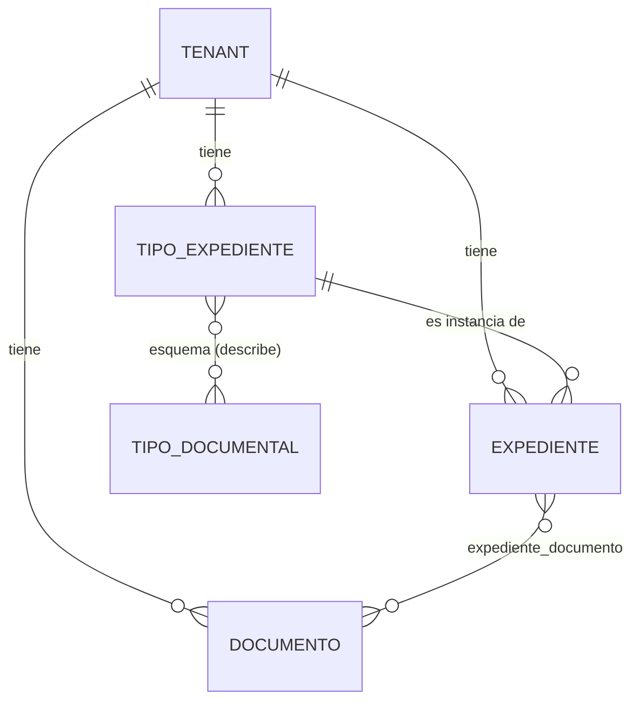

# Modelo de entidades nuevo (en construcción)

Decisión del 2026-10-24 (Moisés, dueño del proyecto): **supersimplificar la base**. Lo que ya existe (las 28 tablas del diccionario v0.4 y
los SPs de `docs/solicitudes-dba.md`) **se queda como está**: no está en uso ni poblado. Ante cada propuesta se crean entidades **nuevas**
y se ve si sirven; no se gasta tiempo en evaluar si las viejas se pueden reutilizar. Este documento es el mapa de lo nuevo.

Mientras no estén los tickets NEX-491 (usuario de migraciones) y NEX-492 (base de desarrollo), cada entidad vive en un registro JSON de solo
agregar por organización (`{ALMACEN_RUTA}/.registro/`, ver `servicios/registro.py`), **con la forma de una tabla**: el día que pasen a SQL
Server cambia el módulo del servicio y no el router ni el front. El DDL entrará solo por archivos de migración versionados en git.

## Entidades

### `tipo_expediente` — `servicios/tipos_expediente.py`, `tipos-expediente-{tenant}.jsonl`

La **clase** de la que salen los expedientes: «expediente médico», «expediente de un choque». Se crea una vez; cada expediente de ese tipo es una
**instancia**: la carpeta de UN paciente, de UN choque, con SUS documentos. El tipo no guarda documentos.

| Campo | Qué es |
|---|---|
| `id` | `tipo-expediente-` + 32 hexadecimales; lo pone el servidor |
| `tenant` | la organización dueña |
| `nombre` | texto libre, hasta 200 caracteres; **único por organización** sin distinguir mayúsculas ni espacios de más |
| `tiposDocumentales` | el **esquema**: lista ordenada, sin repetidos (hasta 50), de ids de tipos documentales de la misma organización; vacía al crear |
| `creadoPor`, `creadoEn` | quién y cuándo |

Dos eventos: `crear` y `esquema` (la lista completa, que reemplaza a la anterior; no se escribe nada si la lista es la misma). Todavía no se renombra
ni se borra. El esquema **describe y no restringe** (ver abajo); lo que falta de un tipo (qué procesos le corren) se agrega cuando haga falta.

### `documento` — `servicios/documentos.py`, `documentos-{tenant}.jsonl`

Un documento **nace al entrar al sistema** (hoy, por la bandeja) y existe por sí mismo: no depende de ningún expediente.

| Campo | Qué es |
|---|---|
| `id` | `documento-` + 32 hexadecimales; lo pone el servidor |
| `tenant` | la organización dueña |
| `sha256`, `rutaRelativa`, `tamanoBytes`, `mime` | el archivo: los bytes viven en el almacén, direccionados por su huella |
| `nombreOriginal` | cómo se llamaba al subirlo |
| `canal` | `API` o `MANUAL` |
| `llaveId` | la API Key con la que llegó (`null` si no fue por llave de cliente) |
| `recibidoEn` | cuándo entró |

Es **una** entidad (no `file` + `document` como en el diccionario v0.4). Subir dos veces el mismo archivo crea dos documentos que comparten bytes.

### `expediente` — `servicios/expedientes.py`, `expedientes-{tenant}.jsonl`

Un conjunto de documentos, y **una instancia de un tipo de expediente**: todo expediente nace de un tipo de su misma organización. Por ahora solo:

| Campo | Qué es |
|---|---|
| `id` | `expediente-` + 32 hexadecimales; lo pone el servidor |
| `tenant` | la organización dueña |
| `tipo` | el `id` del `tipo_expediente` del que es instancia (obligatorio, no cambia) |
| `nombre` | texto libre, hasta 200 caracteres; dos expedientes pueden llamarse igual |
| `creadoPor`, `creadoEn` | quién y cuándo |

### `expediente_documento` — la pertenencia, mismo registro que `expediente`

| Campo | Qué es |
|---|---|
| `expediente`, `documento` | los dos ids |
| `por`, `en` | quién lo metió o lo sacó, y cuándo |

Son dos eventos, `agregar` y `quitar`; el estado vigente se arma doblando el registro. Un expediente admite hasta 1000 documentos.

## Relaciones

- Un tipo de expediente tiene muchos expedientes; cada expediente es de **un solo** tipo, que no cambia.
- **El esquema describe, no restringe.** Un tipo de expediente lista los tipos documentales que se esperan de sus expedientes, pero eso **no limita los
  archivos que una instancia puede recibir**: cualquier documento entra a cualquier expediente, y los que no encajan quedan «sin tipo documental».
  Hoy todos los documentos están así, porque ninguno guarda aún su tipo documental (la clasificación se hace en el navegador y no se persiste).

- Un documento puede estar en **ningún** expediente, en **uno** o en **varios**. Cada pertenencia es independiente.
- **El «void» no es una entidad ni un lugar:** es un documento sin ninguna pertenencia. Todo documento nace ahí.
  `GET /expedientes/documentos?sin_expediente=true` lo lista.
- Sacar un documento de su último expediente lo devuelve solo al void; **nunca se borra un documento por salir de un expediente**.

## Decisiones tomadas (con quién y cuándo)

- **2026-10-24 · Moisés:** un documento nace al entrar; puede entrar a 1 expediente, a varios o al void; el expediente se identifica solo por su
  nombre por ahora; se construye «de lo general a lo particular».
- **2026-10-24 · Moisés:** un expediente **proviene de un tipo de expediente** («expediente médico», «expediente de un choque»); el expediente
  es una instancia de ese tipo y guarda los documentos de cada caso (de cada paciente, de cada choque).
- **2026-10-24 · Moisés:** a un tipo de expediente se le pueden asignar tipos documentales para describir su esquema, pero eso **no limita** los archivos
  que su instancia puede recibir: los que no encajan quedan «sin tipo documental».
- **2026-10-24 · propuesta mía, pendiente de confirmar con César:** solo `roles.PUEDEN_ORGANIZAR` (Administrador, Supervisor, Analista y Operador)
  crean expedientes y meten o sacan documentos; Compliance, Auditor y Viewer solo leen. Los **tipos** de expediente los crea quien administra
  (`roles.PUEDEN_ADMINISTRAR`: Administrador y Supervisor), como la biblioteca de tipos documentales y los procesos; todos los roles los leen.
- **2026-10-24 · propuesta mía:** el nombre de un tipo es único por organización (sin distinguir mayúsculas ni espacios de más), porque todavía no
  se pueden renombrar ni borrar y un repetido por error no tendría arreglo. Si no se quiere, se quita la comprobación.

## Lo que todavía no existe

- **Estado del documento.** Hoy la bandeja lleva aparte si una entrada está pendiente, pasó al pipeline o se descartó; el documento no lo sabe.
- **Lo que sale del procesamiento** (OCR, clasificación, campos extraídos): hoy no se guarda en el servidor.
- **La carga manual del front** no crea documentos todavía: solo nacen los que entran por la bandeja de la API.
- **Del expediente:** renombrarlo, borrarlo, un estado, un folio o una referencia externa del cliente (la que mandaría quien sube por la API).
- **Del tipo de expediente:** renombrarlo o borrarlo (y qué pasa con sus expedientes), y qué procesos del motor de reglas le corren: hoy un proceso corre
  «sobre un expediente» sin saber de qué tipo.
- **El tipo documental de cada documento.** Hoy ningún documento lo guarda (todos están «sin tipo documental»). Con la clasificación guardada en el
  documento —la haga el clasificador o una persona— el expediente podría mostrar qué partes de su esquema están cubiertas y cuáles faltan.
- **El paso a SQL Server:** cuando estén NEX-491 y NEX-492, estas tres entidades se vuelven migraciones nuevas junto a las tablas viejas.

Verificación: `verificar_expedientes.py`.
