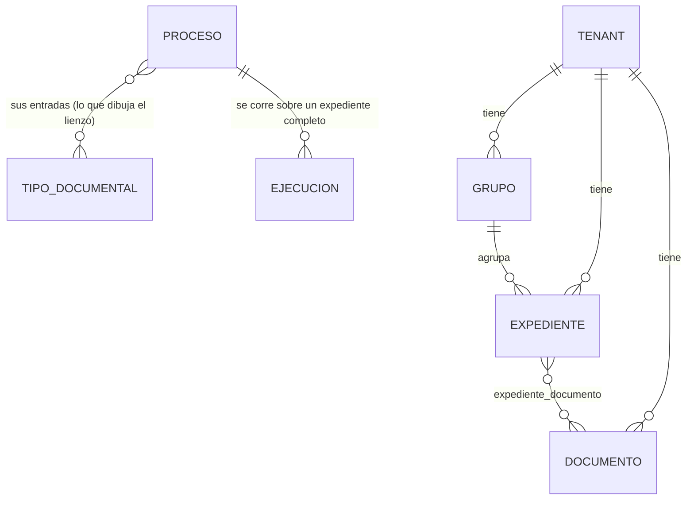

# Modelo de entidades nuevo (en construcción)

Decisión del 2026-10-24 (Moisés, dueño del proyecto): **supersimplificar la base**. Lo que ya existe (las 28 tablas del diccionario v0.4 y
los SPs de `docs/solicitudes-dba.md`) **se queda como está**: no está en uso ni poblado. Ante cada propuesta se crean entidades **nuevas**
y se ve si sirven; no se gasta tiempo en evaluar si las viejas se pueden reutilizar. Este documento es el mapa de lo nuevo.

> **Actualización del 2026-11-05 (Moibe: «voy a quitar los expedientes virtuales, ahora podremos meter el expediente completo a la ejecución de un proceso»).**
> Lo vigente: un **expediente** es un receptáculo de documentos, **sin tipo** (desde el 2026-10-29) y vive en un **grupo** (`servicios/grupos.py`, migración `0010`). La entidad
> `tipo_expediente` —que el 2026-10-29 pasó a ser «tipo de expediente virtual», con los expedientes virtuales que salían de él— **ya no existe**: sus rutas (`/tipos-expediente`
> y `/expedientes/{id}/virtuales`) se quitaron, y un proceso corre sobre el expediente COMPLETO (`servicios/ejecuciones.py`); los tipos documentales que dibuja en su lienzo
> declaran qué documentos necesita. Sus tablas las borra la migración `0012`. Lo que sigue en este documento sobre tipos de expediente se conserva como **historia** y va
> marcado como retirado. Lo único que sobrevive es la marca de **duplicados** (dos o más documentos del mismo tipo documental en un expediente), calculada al leer sobre el
> expediente entero.

Mientras no estén los tickets NEX-491 (usuario de migraciones) y NEX-492 (base de desarrollo), cada entidad vive en un registro JSON de solo
agregar por organización (`{ALMACEN_RUTA}/.registro/`, ver `servicios/registro.py`), **con la forma de una tabla**: el día que pasen a SQL
Server cambia el módulo del servicio y no el router ni el front. El DDL entrará solo por archivos de migración versionados en git.

## Entidades

### `tipo_expediente` — RETIRADA el 2026-11-05

Fue la **clase** de la que salían los expedientes («expediente médico», «expediente de un choque») y, desde el 2026-10-29, la clase de la que salían los **expedientes
virtuales** (subconjuntos de los documentos de un expediente que alimentaban al motor de reglas). Tenía un nombre único por organización, un **esquema** de tipos
documentales (describía, no restringía) y se podía crear, editar, renombrar y borrar. **Ya no existe**: se quitó con los expedientes virtuales (`servicios/tipos_expediente.py`,
`servicios/expedientes_virtuales.py` y sus rutas se borraron; la migración `0012` borra `virtualCaseTypes`, `virtualCaseTypeDocumentTypes`, `virtualCases` y
`virtualCaseDocuments`). Un archivo `tipos-expediente-{tenant}.jsonl` que haya quedado en un almacén es un archivo muerto: nadie lo lee. Las decisiones que lo crearon están
más abajo, marcadas como retiradas.

### `documento` — `servicios/documentos.py`, `documentos-{tenant}.jsonl`

Un documento **nace al entrar al sistema** (hoy, por la bandeja) y existe por sí mismo: no depende de ningún expediente.

| Campo | Qué es |
|---|---|
| `id` | `documento-` + 32 hexadecimales; lo pone el servidor |
| `tenant` | la organización dueña |
| `sha256`, `rutaRelativa`, `tamanoBytes`, `mime` | el archivo: los bytes viven en el almacén, direccionados por su huella |
| `nombreOriginal` | cómo se llamaba al subirlo |
| `canal` | `API` o `MANUAL` |
| `llaveId` | la API Key con la que llegó (`null` si no fue por llave de cliente) |
| `recibidoEn` | cuándo entró |

Es **una** entidad (no `file` + `document` como en el diccionario v0.4). Subir dos veces el mismo archivo crea dos documentos que comparten bytes.

### `expediente` — `servicios/expedientes.py`, `expedientes-{tenant}.jsonl`

Un conjunto de documentos: el **receptáculo** de un caso. **No tiene tipo** (desde el 2026-10-29 deja de ser instancia de un tipo de expediente; el tipo se retiró el 2026-11-05). Por ahora solo:

| Campo | Qué es |
|---|---|
| `id` | `expediente-` + 32 hexadecimales; lo pone el servidor |
| `tenant` | la organización dueña |
| `nombre` | texto libre, hasta 200 caracteres; dos expedientes pueden llamarse igual |
| `grupo` | el grupo en que vive (`servicios/grupos.py`, desde la migración `0010`); obligatorio al crearlo donde hay base, y los de antes pueden no tenerlo |
| `creadoPor`, `creadoEn` | quién y cuándo |

Al leerlo, además, se calcula (sin guardarse): `totalDocumentos`, `tamanoBytes` y los **duplicados** —los tipos documentales con dos o más documentos en el expediente—.

### `expediente_documento` — la pertenencia, mismo registro que `expediente`

| Campo | Qué es |
|---|---|
| `expediente`, `documento` | los dos ids |
| `por`, `en` | quién lo metió o lo sacó, y cuándo |

Son dos eventos, `agregar` y `quitar`; el estado vigente se arma doblando el registro. Un expediente admite hasta 1000 documentos.

## Relaciones

- Un expediente **no tiene tipo**: es un receptáculo. Lo que un proceso necesita de él lo declara el proceso mismo, con los tipos documentales de su lienzo; el proceso corre sobre
  cualquier expediente de la organización y toma de él los documentos de esos tipos. Si el expediente trae dos o más de un mismo tipo, es un **duplicado** y el proceso no corre
  hasta que quede uno.
- *(Retirado el 2026-11-05: «un tipo de expediente tiene muchos expedientes y su esquema describe, no restringe». Los tipos de expediente y sus esquemas ya no existen.)*

- Un documento puede estar en **ningún** expediente, en **uno** o en **varios**. Cada pertenencia es independiente.
- **El «void» no es una entidad ni un lugar:** es un documento sin ninguna pertenencia. Todo documento nace ahí.
  `GET /expedientes/documentos?sin_expediente=true` lo lista.
- Sacar un documento de su último expediente lo devuelve solo al void; **nunca se borra un documento por salir de un expediente**.

## Decisiones tomadas (con quién y cuándo)

- **2026-10-24 · Moisés:** un documento nace al entrar; puede entrar a 1 expediente, a varios o al void; el expediente se identifica solo por su
  nombre por ahora; se construye «de lo general a lo particular».
- **2026-10-24 · Moisés:** un expediente **proviene de un tipo de expediente** («expediente médico», «expediente de un choque»); el expediente
  es una instancia de ese tipo y guarda los documentos de cada caso (de cada paciente, de cada choque). *(RETIRADA: el 2026-10-29 el expediente dejó de tener tipo y el
  2026-11-05 se quitaron los tipos de expediente.)*
- **2026-10-24 · Moisés:** a un tipo de expediente se le pueden asignar tipos documentales para describir su esquema, pero eso **no limita** los archivos
  que su instancia puede recibir: los que no encajan quedan «sin tipo documental». *(RETIRADA el 2026-11-05 con los tipos de expediente.)*
- **2026-10-24 · propuesta mía, pendiente de confirmar con César:** solo `roles.PUEDEN_ORGANIZAR` (Administrador, Supervisor, Analista y Operador)
  crean expedientes y meten o sacan documentos; Compliance, Auditor y Viewer solo leen. *(Lo de que los **tipos** de expediente los crea quien administra quedó retirado con ellos el 2026-11-05.)*
- **2026-10-24 · propuesta mía:** el nombre de un tipo es único por organización (sin distinguir mayúsculas ni espacios de más), porque un catálogo con
  dos «Expediente médico» no sirve. Si no se quiere, se quita la comprobación. *(RETIRADA el 2026-11-05; la misma regla sigue en procesos, grupos y tipos documentales.)*
- **2026-10-24 · Moisés:** *(RETIRADA el 2026-11-05)* los tipos de expediente se pueden **renombrar y borrar**. **Decisión mía al implementarlo, por confirmar:** un tipo **con
  expedientes no se borra** (409 `con_expedientes`), porque borrarlo dejaría expedientes sin clase o habría que destruirlos con él; renombrar sí es libre.
  Cuando haya cómo mover o borrar expedientes, esto se puede aflojar (por ejemplo, borrar el tipo junto con sus expedientes tras una confirmación fuerte).

- **2026-10-25 · Moisés:** *(RETIRADA el 2026-11-05)* un tipo de expediente puede tener **varios** tipos documentales y ese conjunto es su **esquema**; **al crear el tipo hay que
  definirle qué tipos documentales tendrá**. **Decisiones mías al implementarlo, por confirmar:** (1) la regla es de nexus_back y no solo de la pantalla:
  `POST /tipos-expediente/` pide al menos un tipo documental (lista vacía, repetidos o uno que no existe: 400); (2) los tipos que ya existían sin esquema
  siguen así; (3) el esquema inicial va en el mismo evento `crear` y no deja además un `CASE_TYPE_SCHEMA_CHANGED`, así no hay un tipo a medias si algo se
  cae entre dos escrituras. *(El punto de `PUT /{id}/esquema` aceptando una lista vacía se revirtió el mismo día, ver la decisión siguiente.)*
- **2026-10-25 · Moisés:** *(RETIRADA el 2026-11-05)* «un tipo de expediente ya creado debe poder ser editable». **Decisiones mías al implementarlo, por confirmar:** (1) `PATCH
  /tipos-expediente/{id}` edita el nombre, el esquema o los dos en una sola llamada y comprueba todo antes de escribir; (2) **un esquema nunca se deja
  vacío**: editar pide lo mismo que crear (al menos un tipo documental), así que `PUT /{id}/esquema` con `[]` ahora da 400 (antes lo aceptaba); (3) un tipo
  anterior a la regla, sin esquema, **puede renombrarse sin ponerle uno** por la API, pero la pantalla le pide elegir uno para guardar; (4) cada cosa que
  cambia deja su propia anotación (`CASE_TYPE_RENAMED`, `CASE_TYPE_SCHEMA_CHANGED`); (5) si cambian los dos van dos eventos seguidos (ver arriba).

- **2026-11-05 · Moibe:** «voy a quitar los expedientes virtuales, ahora podremos meter el expediente completo a la ejecución de un proceso». Se quitan los expedientes
  virtuales (grupitos de los documentos de un expediente) y los tipos de expediente virtual de los que salían, con sus rutas, su pantalla y el clasificador que metía
  documentos a virtuales (la clasificación SIGUE guardándose: es lo que dice de qué tipo es cada documento). Un proceso corre sobre el expediente **completo** y sobre
  cualquiera de la organización (el grupo del expediente tampoco lo limita); lo que se dibuja en su lienzo declara qué tipos documentales necesita. **Se mantiene** el
  duplicado: con dos o más documentos de un tipo que el proceso usa, la regla no corre, se avisa y los documentos quedan marcados. El historial de ejecuciones conserva el
  virtual de las que ya se corrieron (migración `0011`: las columnas quedan nulas para las nuevas); las tablas de los virtuales las borra la `0012`, que no tiene vuelta atrás.

## Lo que todavía no existe

- **Estado del documento.** Hoy la bandeja lleva aparte si una entrada está pendiente, pasó al pipeline o se descartó; el documento no lo sabe.
- **Lo que sale del procesamiento** (OCR, clasificación, campos extraídos): hoy no se guarda en el servidor.
- **La carga manual del front** no crea documentos todavía: solo nacen los que entran por la bandeja de la API.
- **Del expediente:** renombrarlo, borrarlo, un estado, un folio o una referencia externa del cliente (la que mandaría quien sube por la API).
- **El tipo documental de cada documento** ya se guarda (migración `0007`: la clasificación y los datos extraídos de cada documento) y el expediente lo muestra. Lo que no hay,
  desde que se quitaron los tipos de expediente, es un «esquema» del expediente que diga qué partes están cubiertas y cuáles faltan: lo único que se calcula son los duplicados.
- **El paso a SQL Server:** cuando estén NEX-491 y NEX-492, estas tres entidades se vuelven migraciones nuevas junto a las tablas viejas.

Verificación: `verificar_expedientes.py`.
